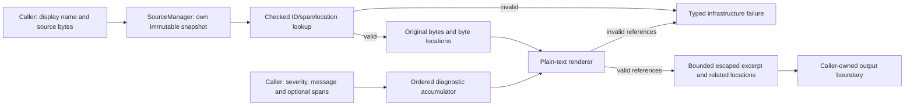

# Phase 2: Source Identity, Spans, and Diagnostics — Research

**Researched:** 2026-10-09
**Mode:** `$gsd-plan-phase --research-phase 2`; research only, inline.
**Domain:** C++ compiler source storage, checked byte spans, byte locations, structured diagnostics.
**Confidence:** HIGH for repository contracts; MEDIUM for externally researched implementation guidance and unexecuted design recommendations.
**Status:** Research complete for owner review. No phase plans or implementation created.

## User Constraints

[VERIFIED: 02-CONTEXT.md] The following decision/discretion and deferred sections
are reproduced verbatim from the committed discussion context. Their references
to later authorization are historical discussion boundaries. The owner has now
authorized research only; this does not authorize a plan, implementation, tests,
commit, CI action, or another lifecycle stage. Research recommendations below
are proposals for review, not additional owner decisions.

## Implementation Decisions

### Source lifetime and identity

- **D-01:** SourceManager owns immutable source buffers. Registered contents and
  derived text views/span backing remain valid for its entire lifetime. Adding
  sources must not invalidate earlier views. No caller-owned buffer lifetime
  obligation is imposed; this is compiler infrastructure, not Veyr ownership
  semantics.
- **D-02:** Every registration creates a fresh SourceId, even when display name
  and bytes are identical. SourceId identifies the registered immutable
  snapshot, never the filesystem path. Multiple IDs may share a display name;
  older snapshots remain intact. Reparsing/incremental/editor use motivates
  the contract but is not implementation scope here.
- **D-03:** SourceId is meaningful only within its originating SourceManager.
  Consumers resolve it through that manager. Different managers may reuse the
  same numeric values for unrelated snapshots. No cross-manager or cross-run
  identity guarantee is required; numeric coincidence cannot establish origin.
- **D-04:** Registration accepts a caller-supplied display name as diagnostic
  metadata only. Names may be paths or labels such as `<memory>`, `<stdin>`,
  `<repl>`, and `<generated>`. SourceManager performs no filesystem lookup or
  path canonicalization during registration. SourceId is authoritative.

### Span validation and text retrieval

- **D-05:** SourceSpan stores SourceId, begin byte offset, and end byte offset,
  with half-open `[begin, end)` semantics. Begin is inclusive and end exclusive.
  Empty spans use `begin == end`; `[source_size, source_size)` is valid EOF.
  Offsets address original source bytes, not decoded characters/code points.
- **D-06:** Public/runtime operations fail explicitly and deterministically for
  unknown SourceId, `begin > end`, or `end > source_size`. Never clamp offsets,
  fabricate text, silently substitute another source, or rely only on debug
  assertions. Assertions may additionally document internal invariants.
- **D-07:** Validation is structural only: SourceId exists in the resolving
  manager and `begin <= end <= source_size`. Every such byte range is valid,
  including a range splitting CRLF. Retrieval preserves exact original bytes.
  Newline representation never affects span identity/validity; interpretation
  belongs to location mapping and rendering.
- **D-08:** Checked failures distinguish at least unknown source, reversed
  range, and beyond-source range. Retain offending SourceId and relevant
  offsets so callers/tests can inspect the invalid input. These are compiler-
  infrastructure failures, not Veyr source-language diagnostics. Do not merge
  them into one generic category or normalize invalid inputs.

### Display names and source locations

- **D-09:** LF is one line break; CRLF is one line break and advances the line
  number exactly once. Lone CR is an ordinary source byte. Original bytes stay
  unchanged. This governs location mapping/rendering only, not lexer whitespace
  or final encoding semantics.
- **D-10:** SourceLocation reports 1-based lines and 1-based byte columns within
  the original line. A tab is one byte/column; non-ASCII UTF-8 bytes count
  individually. Mapping does not decode Unicode or calculate display width.
  Visual caret alignment, tab expansion, and renderer-specific positioning are
  separate from byte locations; Phase 2 rendering has no Unicode-width dependency.
- **D-11:** Boundary rules are exact: LF and both bytes of CRLF belong to the
  preceding line at their respective byte columns. The byte immediately after
  a break is next line, column 1. Empty-source EOF is `1:1`. EOF after a trailing
  break is next line, column 1; otherwise EOF is final line, one byte column past
  its contents. These rules remain independent of visual rendering.
- **D-12:** Preserve exact caller display spelling: separators, casing, drive
  letters, relative components, spaces, and synthetic labels. Do not normalize
  or canonicalize presentation. Stored metadata remains unchanged. Rendering
  escapes control characters so a display name cannot inject extra lines or
  terminal control sequences. Display spelling never affects SourceId.

### Structured diagnostics and plain rendering

- **D-13:** One structured diagnostic model permits location-free messages and
  an optional primary SourceSpan plus zero or more ordered, labelled related
  spans. Never fabricate a source/dummy span for a location-free message.
  Related spans supplement rather than replace an existing primary. The model
  is independent of LLVM and rendering.
- **D-14:** Support Error, Warning, and Note. Accumulated Error diagnostics make
  `has_errors()` true; any Error prevents successful compilation. Warning/Note
  alone do not affect it. Rendering does not determine severity/error state.
  This is infrastructure only; warning groups, suppression, warnings-as-errors,
  and final language warning policy are outside Phase 2.
- **D-15:** Plain output contains severity/message, primary stored
  `display-name:line:column` when present, a bounded source excerpt around the
  primary location, an ASCII caret/underline for that span, then ordered,
  labelled related locations. Location-free diagnostics render their structured
  message without fabricated source context. Use the stored SourceManager
  snapshot/name, with no filesystem lookup, required color, terminal-specific
  capability, or Unicode-width dependency. Output is deterministic plain text.
- **D-16:** Accumulate in caller insertion/emission order. Do not automatically
  sort by source/location, deduplicate repeated messages, reorder by severity,
  or apply severity filtering. Repeated diagnostics remain observable. Future
  grouping/deduplication is an explicit presentation/query operation, not part
  of the accumulator contract.

### Research and planning boundaries

The owner selected every substantive preference explicitly; none was delegated
through a "you decide" answer. Normal implementation details may be investigated
only after the separate planning authorization and within the contracts above.

Later research/planning must specify and review, without silently expanding scope:

- Stable storage, checked API/result representation, SourceId/offset capacity
  handling, and source lifetime/move restrictions sufficient for D-01 through
  D-08. Never promise detection of cross-manager origin from a manager-local
  numeric ID alone.
- Line indexing and checked location lookup, including empty sources, offsets
  on both CRLF bytes, mixed LF/CRLF, lone CR, and EOF boundary cases.
- Bounded excerpt limits, multiline/zero-width/EOF marker layout, deterministic
  tab/control/non-ASCII byte presentation, and control escaping. No final encoding
  or Unicode-width policy may be inferred from a renderer implementation.
- Renderer handling of invalid referenced IDs/spans and output failures within
  the explicit checked/fail-closed contract, without fabricated source context.
- Ownership of diagnostic messages/labels, collection access, and lightweight
  source/diagnostic target/test integration without LLVM or driver coupling.

These are remaining implementation details for the later reviewed plan, not
new owner-selected defaults, executable changes, or new language capabilities.

## Deferred Ideas

No new phase scope was added. Potential future incremental/reparse/editor
use, `<repl>`/`<generated>` labels, and explicit UI grouping/deduplication explain
contracts but do not authorize those capabilities.

Remain outside Phase 2: final source encoding/Unicode width, lexer whitespace
and grammar, warning policy/groups/suppression/warnings-as-errors, colored/JSON/
SARIF/LSP output, virtual filesystem/file discovery, persistent source identity,
full modules/packages, and macOS bring-up. Phase 3 profile work and all later
compiler phases require their own exact owner commands.

## Project Constraints (from AGENTS.md)

[VERIFIED: AGENTS.md; docs/development/GSD_WORKFLOW.md; .planning/config.json]

- Read canonical design, development, project-system and tooling documents;
  explicit owner decisions and DECISION_LOG.md take precedence. Keep Veyr,
  veyrc, veyrcore, .vyr, Veyr.toml and Veyr.lock names unchanged.
- Research/planning writes belong in `.planning/` or explicitly approved
  planning documents. Do not create source, tests, CMake targets or generated
  implementation; do not run builds/tests, formatters or package operations.
- No automatic lifecycle transition, commit, push, verification, or next phase.
  `commit_docs: true` is not commit permission. No sub-agents were requested;
  the skill adapter's inline fallback applies under the repository restriction.
- C++23, existing CMake/Ninja/Clang and GoogleTest/GoogleMock remain the stack.
  Owned includes use `<veyr/...>`. Preserve compile database/include guardrails.
- Conan 2.33.0 owns third-party mechanics; backend LLVM remains 23.1.2.
  No new provisioning, solver, package store, SDK normalization, or lock format.
- Source/diagnostics must not depend on LLVM, driver/build state, lexer/parser,
  AST or semantics. Do not infer final language memory/error/encoding semantics
  from C++ infrastructure choices. No syntax-dependent work before Phase 3's
  separately reviewed M1 Experimental Smoke Profile.
- Windows/Linux x86_64 remain Tier 1. Linux is primary development; Windows
  developer-host evidence is independently pending and non-blocking for Phase 2
  planning. macOS remains deferred. Preserve caller paths without OS lookup.
- Future execution uses explicit setup, build-may-configure, test-may-build,
  all-includes-setup semantics; long healthy quiet builds require liveness
  inspection, not automatic termination or duplicate retries.
- Future sensitive implementation commits require a review packet and explicit
  owner approval. Current research creates no such implementation changes.

## Summary

[VERIFIED: .planning/ROADMAP.md Phase 2; REQUIREMENTS.md; 02-CONTEXT.md]
The seven requirements are a compiler-infrastructure slice: immutable snapshots,
checked half-open byte spans, locations, structured diagnostics and plain output.
P01 needs retained text across later stages; PLAT_01 and PLAT_03 require portable
metadata and deterministic presentation. No lexer, driver input loader, VFS,
incremental engine or final language spelling is required.

[RECOMMENDATION] Use the existing standard library and core/test targets. Store
each source record behind an owning pointer, publish only immutable views, and
resolve manager-local IDs through one checked lookup. Index starts immediately
after LF bytes; this directly implements the approved LF/CRLF boundary rules.
Own diagnostic messages/labels, retain emission order, and render through a
separate checked function. Keep the result representation and renderer small.

[CITED: S5; S6] One concrete compatibility constraint changes the tempting
API choice: upstream GCC 13.3's `<expected>` requires `__cpp_concepts >= 202002L`,
while upstream Clang 18.1.3 defines it as `201907L`. Thus the reviewed Ubuntu
Clang-18/GCC-13 combination cannot be assumed to expose `std::expected` merely
because C++23 mode is enabled. This is a source-level deduction, not a compiler
probe run here. Use `std::variant` with small named error records rather than
changing the accepted compiler/standard-library baseline or defining feature
macros to bypass the guard. Exact runner header compilation remains execution
evidence, not a research claim.

**Primary recommendation:** [RECOMMENDATION] Implement the smallest standard-
library source/diagnostic substrate, with portable checked results and explicit
rendering limits reviewed in the later plan. Reuse the accepted foundation.

## Standard Stack

| Component | Version/contract | Research use and provenance |
|---|---|---|
| C++ | C++23; existing compiler profiles | Implementation language; no baseline change. [VERIFIED: AGENTS.md; CMakeLists.txt] |
| Standard containers/views | `string`, `string_view`, `vector`, `unique_ptr`, `variant`, `optional` | Ownership, immutable retrieval, typed checked results and optional primary. [RECOMMENDATION; CITED: S1–S4, S7] |
| Build integration | Existing CMake minimum 3.31 + Ninja | Extend existing target source lists and target policy. No new framework. [VERIFIED: CMakeLists.txt; cmake/VeyrTargets.cmake] |
| Unit tests | Conan GoogleTest/GoogleMock 1.18.0 | Existing target/discovery pattern. [VERIFIED: tests/CMakeLists.txt] |
| Third-party mechanics | Conan 2.33.0; LLVM backend 23.1.2 unchanged | Existing dependency policy only; source/diagnostic code does not use LLVM types. [VERIFIED: AGENTS.md; 01-08-SUMMARY.md] |
| Development/CI compilers | Omarchy Clang 22.1.8; Ubuntu CI Clang 18.1.3/GCC-13; Windows CI standalone clang-cl 20.1.8/VC environment | Independent accepted foundation environments, not a request to align versions. [VERIFIED: 01-08-SUMMARY.md; scripts/devtools/baseline.json] |

[VERIFIED: CMakeLists.txt; tests/CMakeLists.txt] No new external package is
needed or recommended. No install commands, package registry audit, Conan graph
work, new lock or recipe revision is part of this research. Existing exact
dependencies remain accepted Phase 1 inputs, not newly verified here.

### Alternatives and exclusions

| Approach | Assessment |
|---|---|
| Inline `vector<SourceRecord>` containing strings | Reject for the lifetime contract: vector relocation can move the records; inline short strings make apparently stable character views especially unsafe. [DERIVED: S1–S3; D-01] |
| `vector<unique_ptr<const SourceRecord>>` | Recommend: vector may move owners while the final immutable records stay at stable addresses. Build the record completely before publication. [DERIVED: S1–S3; D-01] |
| `deque<SourceRecord>` | Possible stable append-only storage alternative, but not required; prefer explicit stable ownership for easier lifetime review. [RECOMMENDATION] |
| `std::expected` | Do not require it on the current Ubuntu compiler/library pair; avoid a new polyfill dependency or toolchain change. [DERIVED: S5, S6] |
| LLVM SourceMgr, Error or diagnostic classes | Do not use in this layer; owner explicitly requires source/diagnostics independence from LLVM. [VERIFIED: AGENTS.md; 02-CONTEXT.md] |
| Arena, shared ownership, general Result framework | Unnecessary for this slice. Use ordinary ownership and local variant aliases; do not implement generic monadic/error infrastructure. [RECOMMENDATION] |

## Architectural Responsibility Map

[RECOMMENDATION based on D-01–D-16 and existing core layout]

| Capability | Owner | Boundary |
|---|---|---|
| Snapshot identity, bytes, display metadata, line index | SourceManager/source component | No filesystem or compiler-driver dependency |
| Span/location validation and typed failure | Source component | Same checked lookup used by retrieval and rendering |
| Severity, optional primary, ordered labelled related spans | Diagnostic value model | Source value types only; no LLVM or renderer state |
| Owned ordered collection and `has_errors()` | Diagnostic accumulator | Rendering cannot alter severity/order/duplicates |
| Excerpts, escaping, ASCII markers and related locations | Plain-text renderer | Reads originating SourceManager; reports invalid references explicitly |
| Writing to terminal/file and compilation exit status | Future caller/driver | No global streams, console capability probing or process exit in these layers |



## Architecture Patterns

### 1. Stable records and manager-local IDs

[CITED: S1–S3] Vector reallocation invalidates references to vector elements;
moving a unique owner transfers its stored pointer; string views rely on their
backing character storage. [DERIVED] An append-only vector of owning pointers
to completed const records therefore separates index growth from source storage.

[RECOMMENDATION] Construct the owned name, full byte string and line index in
the final heap record before exposing views. Copy from caller input or accept
owned strings by value, then publish views only after the final move. Do not
retain a view into an input argument or temporary. Do not mutate, replace,
erase or clear published records. `reserve()` alone cannot establish D-01.

[RECOMMENDATION] Make SourceManager non-copyable and non-movable initially;
do not expose reset/swap APIs. This prevents moving storage away from a still-
live originating manager. It is a C++ API implementation proposal, not a Veyr
pinning/lifetime semantic decision. Const views borrow until manager destruction.
No concurrent registration/lookup guarantee is proposed; avoid adding locks or
parallel execution to this phase.

[RECOMMENDATION] Use a small strong SourceId wrapper with an explicit invalid
sentinel and monotonic dense registration index. Do not hash/canonicalize names
or deduplicate bytes. Before publishing an ID, guard index arithmetic/conversion
and exhaustion; an exhausted registration must not reuse an older ID. A local
capacity error is sufficient, without a general allocation/provenance framework.

[VERIFIED: D-03] A foreign manager's numerically equal ID cannot be distinguished
from a local ID by number alone. Document originating-manager responsibility;
do not promise cross-manager detection, generation tags or persistent identity.

### 2. One checked path for spans, text and location

[RECOMMENDATION] Use unsigned size-compatible byte offsets without narrowing.
Provide explicit typed success/error results; prefer named aliases over a new
generic framework. Keep error kind, original SourceId, original begin/end (or
queried point), and known source size available. Unknown-source failures cannot
invent a size; represent its absence explicitly. Mark checked operations
`[[nodiscard]]`. Consume variants through checked alternatives; `get_if` returns
null on an absent alternative. [CITED: S7]

[RECOMMENDATION] Define deterministic precedence for multiply invalid spans in
the reviewed plan: unknown source first, then reversed range, then beyond size.
Only after `begin <= end <= size` perform subtraction or construct the view.
Location queries similarly require `offset <= size`. No slicing helper may
clamp or convert these failures into Veyr-language Error diagnostics.

[RECOMMENDATION] Preserve explicit string/view lengths, embedded NUL, tabs,
non-ASCII bytes, CRLF splits and EOF. `string_view::substr` has bounds behavior
of its own, but is not a substitute for D-08's typed structural checks.
[CITED: S9] Keep diagnostic messages/labels owned separately from snapshot views.

[RECOMMENDATION] Review representation capacity explicitly: `size + 1` for EOF
columns and line counts must not wrap. Reserve representable headroom or report
a checked capacity failure before registering an unrepresentable snapshot.
Do not promise infallible allocation or select Veyr's unresolved OOM policy.
Keep ordinary C++ allocation failure distinct from invalid-ID/span errors.

### 3. LF-derived index implements the approved CRLF boundaries

[DERIVED: D-09–D-11] Initialize `line_starts` with zero and append `i + 1` for
each original LF byte. A preceding CR needs no extra start. Lone CR adds no
start. Include a start equal to source size after a trailing LF. For a checked
point, find the last start not greater than the point, then report one-based
line index and `point - start + 1` byte column. `upper_bound` supplies this
partition search on a sorted random-access index. [CITED: S8]

[DERIVED: D-09–D-11] This maps both CRLF bytes to the preceding line and moves
only the following byte to the next line. Original text is never rewritten.
The index costs one pass over source bytes plus stored line starts; lookups
use logarithmic comparisons in line count. No decoder, locale or path API is
needed. Newline rules here do not select the future lexer's whitespace policy.

| Original bytes | Offset(s) | Required location(s) |
|---|---|---|
| empty | EOF 0 | 1:1 |
| `a` | 0, EOF 1 | 1:1, 1:2 |
| `a\n` | LF 1, EOF 2 | 1:2, 2:1 |
| `a\r\n` | CR 1, LF 2, EOF 3 | 1:2, 1:3, 2:1 |
| `a\rb` | CR 1, `b` 2, EOF 3 | 1:2, 1:3, 1:4 |
| `\r\n\n` | CR 0, LF 1, LF 2, EOF 3 | 1:1, 1:2, 2:1, 3:1 |

[DERIVED: D-10] Tabs and each non-ASCII byte increment the mapping by one;
rendered cells may occupy several positions. Test byte locations independently
from caret alignment so visual policy cannot alter source coordinates.

### 4. Own structured diagnostic values and preserve insertion order

[RECOMMENDATION based on D-13–D-16] Use a severity enum, owned message,
`optional<SourceSpan>` primary, and vector of `{SourceSpan, owned label}` related
values. Store diagnostics in insertion order without sorting or deduplication.
Calculate `has_errors()` from the collection, or maintain an error count only
if mutation/reset behavior is explicitly defined. A scan is simplest initially.
Expose read-only iteration; document that accumulator container views need not
have SourceManager's stronger append-stability guarantee.

[VERIFIED: D-14] An Error blocks successful compilation even when rendering
fails; Warning/Note alone do not. Phase 2 exposes that state to future callers;
it does not extend the version-only driver to compile input or introduce warning
groups, suppression, warnings-as-errors, codes, fix-its or a reporting framework.

### 5. A checked renderer with bounded work and deterministic escaping

[RECOMMENDATION] Prefer rendering one diagnostic into an owned string or typed
infrastructure failure. Validate primary and all related spans before emitting
the returned string; retain which reference failed and the source error details.
Never fabricate context or partially pretend a rejected diagnostic succeeded.
Keep stream/file writes outside the formatter. If a later plan instead selects
an ostream API, it must propagate stream failures; rendering success cannot
assert delivery success. No console I/O abstraction is needed here.

[RECOMMENDATION] Make the rendering proposal explicit in the plan: fixed labels
for severity, primary name/line/column, a bounded primary window, ASCII marker,
then related labels/locations in stored order. For primary-less diagnostics,
render no fabricated excerpt/location. The plan must clarify presentation of
related spans when a primary is absent without discarding valid related context.

[RECOMMENDATION] Use bounded line and byte windows around the primary anchor,
with deterministic clipping/continuation indicators. Do not copy or allocate
spaces for an arbitrarily large entire line/span. For multiline spans, select
bounded endpoint/context lines; do not expand the whole span. Empty/EOF spans
still require a visible caret. A span on either newline byte belongs to the
preceding line, so the renderer must define an end-marker or escaped-terminator
layout rather than clamping or moving its source location.

[RECOMMENDATION] A small portable presentation option is printable ASCII plus
explicit escapes for control/non-ASCII bytes (including tabs and ESC), with a
byte-boundary-to-rendered-cell map for the displayed window. Escape backslash
consistently to avoid ambiguous literal/escape spellings. Keep source/name bytes
unchanged; apply escaping only in presentation. This avoids console encoding
and Unicode-width dependencies without declaring an encoding valid or invalid.
Apply control escaping to names and source excerpts; review message/label
escaping too. Exact escape grammar, limits and clipping layout remain proposals
for owner-reviewed planning, not locked discussion decisions.

### Existing integration and candidate file seams

[VERIFIED: CMakeLists.txt; tests/CMakeLists.txt; include/veyr/build_info.hpp;
src/core/build_info.cpp; src/driver/main.cpp] `veyrcore` is currently a static
library containing build_info; `veyrc` is version-only. Foundation tests link
core and GoogleTest/GoogleMock, while LLVM Support tests have their own target.
No existing source manager or diagnostic implementation was found in tracked
`include/` or `src/`. CMake's PRE_TEST discovery is already used. [CITED: S10]

[RECOMMENDATION] Extend this small structure; directory separation is enough.
The later planner can use these candidate seams, without creating them now:

| Candidate path | Responsibility / nearest existing pattern |
|---|---|
| `include/veyr/source/source_id.hpp`, `source_span.hpp`, `source_location.hpp`, `source_manager.hpp` | Plain value types and checked manager API; public include convention from build_info.hpp |
| `src/source/source_manager.cpp` | Owning records, validation, indexing and views; core translation-unit pattern |
| `include/veyr/diagnostics/diagnostic.hpp`, `diagnostic_engine.hpp`, `plain_text_renderer.hpp` | Owned structured values, ordered accumulation, checked rendering |
| `src/diagnostics/diagnostic_engine.cpp`, `plain_text_renderer.cpp` | Minimal implementation; no LLVM/process/filesystem APIs |
| `tests/source/source_manager_test.cpp`, `tests/diagnostics/diagnostic_test.cpp`, `plain_text_renderer_test.cpp` | GoogleTest byte/boundary/error/render cases using existing native test pattern |
| `CMakeLists.txt`, `tests/CMakeLists.txt` | Add sources/tests under existing target policy and PRE_TEST discovery |

[RECOMMENDATION] Exact file count, result-type placement and target naming belong
to the later plan; consolidate tiny value headers if clearer. Do not add a
separate build framework, executable, CLI flag, dependency, workflow, profile or
lock. Global root configuration still discovers LLVM as accepted in Phase 1;
that does not justify linking source/diagnostic code to LLVM. New unit tests
should link `veyrcore` and GTest, not the LLVM Support target.

## Don't Hand-Roll

| Problem | Use / boundary |
|---|---|
| Ownership, containers, checked tagged alternatives | Standard library; no arena/refcount or Result framework. [RECOMMENDATION] |
| Line-index search | Standard `upper_bound` over starts; small approved newline scan is domain logic. [RECOMMENDATION; CITED: S8] |
| Dependency provisioning or storage | Existing Conan only; no Phase 2 package work. [VERIFIED: AGENTS.md] |
| Path resolution or source discovery | None: caller metadata and immutable bytes only. [VERIFIED: D-04, D-12] |
| Unicode decoding, grapheme/display width, console control | Outside scope; deterministic byte presentation proposal only. [VERIFIED: D-10, D-15] |
| Test orchestration/report formats | Existing GoogleTest/CMake/developer commands; no snapshot service or new runner. [RECOMMENDATION] |

## Common Pitfalls

[DERIVED: D-01–D-16; S1–S9]

| Pitfall | Prevention and later evidence |
|---|---|
| Views survive a few inserts but dangle on growth | Heap-stable immutable records; force many registrations with short and large strings; assert old data pointer and exact bytes |
| Copy/move/reset releases a live manager's source data | Restrict manager movement/reset; review API and compile-time type traits later |
| A path map reuses IDs | Register identical name/bytes repeatedly; distinct IDs, preserved old snapshots |
| C++23 mode assumed to guarantee every library facility | Avoid `expected` on Clang-18/GCC-13; no feature-macro spoofing or baseline changes |
| C-string APIs truncate embedded NUL | Use explicit lengths and byte comparisons in construction/retrieval/rendering |
| Validation subtracts before checking or narrows to int | Ordered structural checks; extreme offsets and exact error payloads |
| CRLF becomes two breaks or lone CR becomes a break | LF-derived starts and table-driven boundary fixtures |
| EOF after a final LF maps to the preceding line | Retain trailing empty-line start, including source-size start |
| Byte column reused as visual caret column | Escape-aware mapping only in renderer; source mapping stays byte-based |
| Renderer emits source/path control sequences | Escape presentation bytes; exact metadata and source retrieval remain unchanged |
| Huge line/span defeats a nominal line limit | Bound bytes/cells and marker construction as well as line count |
| Bad related span silently dropped | Validate all references; explicit typed infrastructure failure |
| Severity/order semantics depend on renderer | Separate accumulator; mixed severities, duplicates, related-order tests |

## Code Examples

These are [RECOMMENDATION / DERIVED] research sketches only; they are not
implementation files, accepted final APIs or language syntax. Library semantics
were checked against S1–S9. Nothing below was compiled or tested in this stage.

### Stable source ownership and local checked result

```cpp
// Proposed shape; names/error payload layout require plan review.
struct SourceRecord {
  std::string display_name;
  std::string bytes;
  std::vector<std::size_t> line_starts;
};

// Construct the final record before exposing any views.
std::vector<std::unique_ptr<const SourceRecord>> sources;
using TextResult = std::variant<std::string_view, SourceError>;
// SourceError retains distinct kind, original ID/offsets and optional known size.
// Inspect with std::get_if; no LLVM type or generic Result implementation.
```

### Required validation order, proposed precedence

```text
lookup source by ID, checked
if absent: return UnknownSource with original input
if begin > end: return ReversedRange with original input and known size
if end > size: return BeyondSource with original input and known size
return immutable source view sliced to [begin, end)
```

### Boundary mapping

```text
starts = [0]
for each original byte index i:
    if bytes[i] == LF: append i + 1 to starts
require known source and offset <= size
next = upper_bound(starts, offset)
index = distance(starts.begin, next) - 1
line = index + 1
column = offset - starts[index] + 1
```

[DERIVED: D-09–D-11] `starts` is nonempty and starts at zero, so a checked
nonnegative point always has a preceding start. Capacity guards described above
must make the one-based additions representable; this sketch omits their API.

## Validation Architecture (future execution only)

[RECOMMENDATION] Use deterministic unit cases and small exhaustive loops over
short byte strings; no new property-testing dependency or corpus machinery.
Create neither tests nor VALIDATION.md in this research-only invocation. The
following is evidence guidance for the later planner, not an executable plan.

| Requirement | Discussion decisions | Minimum future evidence |
|---|---|---|
| SRC-01 | D-01–D-04 | Caller input destroyed/modified after registration; retained short/long/empty views across growth; fresh duplicate IDs; manager-local identity; exact names |
| SRC-02 | D-05–D-08 | Empty/full/EOF/CRLF-split spans valid; each invalid category and original payload checked in Release as well as Debug; arithmetic extremes fail closed |
| SRC-03 | D-01, D-05–D-08 | Exact original substring with NUL, CRLF, tabs and non-ASCII bytes; no duplicated lexeme storage or normalized bytes |
| SRC-04 | D-04, D-09–D-12 | All newline/EOF table cases plus mixed breaks, byte columns, Windows drive/UNC/relative spellings and Linux names; no filesystem interaction |
| DIAG-01 | D-08, D-13 | Location-free, primary-only and ordered labelled related values; renderer reports invalid primary/related input; no LLVM headers/types |
| DIAG-02 | D-09–D-13, D-15 | Exact plain rendering of bounded single/multiline/empty/EOF/newline/control/tab/high-byte cases; clipping and source preservation; no ANSI/color/console dependence |
| DIAG-03 | D-14, D-16 | Error vs Warning/Note state, emission order, duplicate preservation, renderer independence and owned messages/labels |

[RECOMMENDATION] Snapshot-style assertions can compare returned strings directly
in GoogleTest; no external golden-file framework is necessary. Encode CRLF and
non-ASCII test bytes explicitly so Git checkout newline conversion, compiler
source encoding and terminal rendering cannot alter input fixtures. Test invalid
inputs in release-mode runtime checks, not only debug assertions.

[VERIFIED: 01-08-SUMMARY.md; docs/development/DEVELOPER_BOOTSTRAP.md]
The accepted foundation supplies shared commands and independent native
Windows/Linux Debug/Release CI. [RECOMMENDATION] Later authorized execution
should reuse those paths and caches, including include-policy and verify. Do
not pin Phase 2 success to the old total of 35 tests: report actual discovered
counts including new source/diagnostic cases. Native Tier 1 results are still
future Phase 2 evidence; Phase 1 passing tests do not validate new components.

## State of the Art / Compatibility Notes

[CITED: S5, S6] Language mode and standard-library availability are separate
constraints. The pinned GCC/Clang source guard is more useful here than a claim
that a newer C++23 abstraction must work everywhere. Avoid a toolchain upgrade
or vendored library solely to obtain a checked value/error API.

[VERIFIED: CMakeLists.txt; tests/CMakeLists.txt; 01-08-SUMMARY.md]
Existing targets and accepted four-row CI already provide the needed execution
path. [RECOMMENDATION] Build on that rather than repeating setup research,
introducing infrastructure layers, or reopening accepted Phase 1 decisions.

## Open Questions for Plan Review

[RECOMMENDATION] These are bounded C++/presentation details left open by the
discussion. They must be explicit in the reviewed plan; research does not lock
them or authorize implementation. No owner-selected D-01–D-16 decision changes.

1. **Exact checked API and capacity:** Select SourceId/offset representation,
   sentinel, capacity failure, error precedence and payload layout. Recommend
   local variants and no manager copy/move/reset. Do not conflate C++ allocation
   handling with Veyr's unresolved OOM policy.
2. **Renderer bounds and escaping:** Choose line/byte/cell limits and clipping
   layout. Recommend deterministic ASCII byte escapes with a local cell map;
   specify tab, control/non-ASCII, backslash and display-name treatment without
   selecting source encoding. No numeric limit is accepted in this research.
3. **Multiline/newline/empty/EOF markers:** Define visible bounded rendering
   when spans split CRLF or fall on the line terminator; preserve exact original
   source location and never clamp a span to fit presentation.
4. **Related-only diagnostics and output failures:** Preserve optional primary
   plus ordered related context. Decide exact related-only layout and checked
   renderer failure shape. Recommend returned text plus explicit source error,
   with delivery failure owned by the future output caller.
5. **File/API integration size:** Finalize minimal header/translation-unit/test
   grouping in existing targets. Do not introduce SourceManager filesystem
   loading, thread-safe registration, driver compile commands, lexer syntax or
   extensible reporting/backend frameworks.

## Sources and Provenance

Sources below were opened in this research session. Only upstream source,
standard draft text and official CMake documentation support external technical
claims. Search snippets/community discussions were not used as authority.
No external code was copied into implementation. Current draft links support
only the established container/view/search semantics used here, not new C++26
features. [VERIFIED: research tool outputs]

| ID | Primary source | Finding |
|---|---|---|
| S1 | [C++ draft: vector modifiers](https://eel.is/c++draft/vector.modifiers) | Reallocation invalidates vector element references/pointers |
| S2 | [C++ draft: unique_ptr constructors](https://eel.is/c++draft/unique.ptr.single.ctor) | Owner move transfers stored pointer |
| S3 | [C++ draft: string_view](https://eel.is/c++draft/string.view.template) | Character-storage lifetime/invalidation remains relevant to views |
| S4 | [GCC 13.3 manuals](https://gcc.gnu.org/onlinedocs/13.3.0/) | Versioned upstream documentation context |
| S5 | [GCC 13.3.0 expected header, lines 25–47](https://raw.githubusercontent.com/gcc-mirror/gcc/releases/gcc-13.3.0/libstdc%2B%2B-v3/include/std/expected) | C++ and concepts feature guard |
| S6 | [Clang 18.1.3 InitPreprocessor.cpp, lines 655–675](https://raw.githubusercontent.com/llvm/llvm-project/llvmorg-18.1.3/clang/lib/Frontend/InitPreprocessor.cpp) | Concepts macro remains 201907L in C++20/C++23 initialization |
| S7 | [C++ draft: variant access](https://eel.is/c++draft/variant.get) | Checked `get_if` alternative inspection |
| S8 | [C++ draft: upper_bound](https://eel.is/c++draft/upper.bound) | Partition lookup and logarithmic comparison bound |
| S9 | [C++ draft: string_view operations](https://eel.is/c++draft/string.view.ops) | Substring operation and bounds semantics |
| S10 | [CMake 3.31: GoogleTest integration](https://cmake.org/cmake/help/v3.31/module/GoogleTest.html) | PRE_TEST discovery matches existing native test integration |

### Repository evidence and precedence

[VERIFIED: git history; 02-CONTEXT.md; 02-DISCUSSION-LOG.md; 01-08-SUMMARY.md]
Discussion commit is `910be08de5cacfa4f585e5e548698644760dc6fd`; Phase 1 closeout
is `1f7e67d11ea6a68790d29b27bd3e1750a1c5d29f`, with final acceptance run
`37826767824`. Phase 1 stays closed at 8/8. Existing context/log/STATE status
wording describes the pre-commit discussion capture; git history establishes
that its review/commit/push subsequently completed. Generic stale pending prose
in older foundation/bootstrap documents does not reverse accepted closeout.
Those completed artifacts were not rewritten for this research.

[VERIFIED: repository reads] Reviewed canonical scope/design documents include
AGENTS.md, DECISION_LOG.md, VISION.md, FEATURE_CATALOG.md, MEMORY_MODEL.md,
TYPE_SYSTEM.md, MODULE_SYSTEM.md, OPEN_QUESTIONS.md, DESIGN_PROBES.md, milestone
strategy/M1, PLAT_01/PLAT_03, GSD_PROJECT_DESCRIPTION.md, PROJECT/ROADMAP/
REQUIREMENTS/STATE and committed Phase 2 context/log. Development workflow,
build/bootstrap/include/cross-platform/command/handoff/commit/review/Git/skills/
role policies, VEYR_TOML.md and TOOLCHAIN.md constrain integration. Concrete core,
test, profile and baseline reads ground reuse; they do not authorize changes.

### Research tooling and evidence limits

[VERIFIED: GSD init/research-plan/classify-confidence queries]
Init identifies Phase 02, seven requirement IDs, existing context and no research
or plans. Five bounded documentation questions were routed through the research
seam; none had a fresh cache hit. Context7 tools and `ctx7` were unavailable, so
official web documentation/upstream source were read directly. The installed
confidence seam returns MEDIUM for websearch verified against official sources;
external findings retain that conservative classification. Repository facts are
tagged VERIFIED; deductions and recommendations are labelled separately. No
old Veyr run's research/evidence or cached implementation was imported.

[VERIFIED: this invocation's command scope] No compiler, CMake, Ninja, CTest,
Conan, dependency/bootstrap, unit/static implementation test or formatter ran.
Code examples and algorithm reasoning are not tested implementation evidence.
Only document completeness, copied constraints, whitespace and change-scope
inspection are appropriate here. Research-only exits before planner,
pattern-mapper, plan-checker, VALIDATION.md generation or execution.

## Platform Impact

- **Windows:** [VERIFIED: D-04, D-09–D-12, D-15; 01-08-SUMMARY.md]
  Preserve Windows spelling and CRLF bytes without path/console APIs. Explicit
  byte fixtures and deterministic ASCII presentation recommendations avoid
  checkout/console dependencies. Existing Windows CI remains the Tier 1
  compatibility route; independent developer-host confirmation stays pending
  and non-blocking. No toolchain/CRT/DevShell behavior changes are proposed.
- **Linux:** [VERIFIED: 02-CONTEXT.md; 01-08-SUMMARY.md; S5, S6]
  Omarchy primary development remains distinct from Ubuntu CI. The conservative
  variant result recommendation accommodates Clang 18/GCC-13 without upgrading
  CI to developer Clang 22 or changing libstdc++. Same byte contracts apply.
- **macOS future:** [VERIFIED: AGENTS.md; 02-CONTEXT.md]
  Still deferred; standard-library source/diagnostic boundaries do not require
  Win32/POSIX filesystem or terminal behavior. No Darwin validation claimed.

## Metadata and Owner Gate

**Confidence breakdown:** Repository scope/contracts HIGH; primary-document
findings MEDIUM under the installed confidence seam; proposed API/layout and
performance behavior MEDIUM until reviewed and executed on the selected stack.
**Validity:** Pinned compiler/header observations apply to the named upstream
versions; recheck if reviewed compiler or standard-library inputs change.
**Open language decisions:** Remain deferred; no new final language semantics.
**Output:** `02-RESEARCH.md` only. STATE/ROADMAP/REQUIREMENTS and discussion
artifacts are unchanged. No phase completion or requirement acceptance changes.

Research is ready for owner review. Resolve the separate research artifact
review/commit boundary before later planning, unless the owner explicitly
defers that commit. Suggested research-only message:
`docs: research Phase 2 source and diagnostics foundation`.
The later exact planning command is `$gsd-plan-phase 2`; do not run it
automatically. No commit or push is authorized by this research command.
