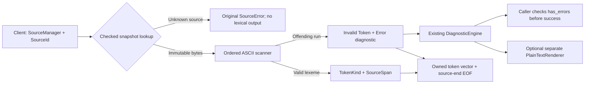

# Phase 3: M1 Experimental Smoke Profile, Tokens, and Lexer — Research

**Researched:** 2026-10-15
**Domain:** C++23 byte lexer over owned immutable source snapshots
**Confidence:** MEDIUM for external documentation (installed confidence seam); repository contracts inspected directly
**Lifecycle:** Research/planning only. No profile, source, test or CMake implementation has been created by this research.

<user_constraints>
## User Constraints (from CONTEXT.md)

The following accepted constraints are copied verbatim. Their authority is the owner-reviewed CONTEXT, published in fe6ed549c2fdade0efd2b46738e83ae9ea7fe0d6. The historical capture status in that document does not undo subsequent owner authorization for research/planning. [VERIFIED: 03-CONTEXT.md; git HEAD]

<!-- DATA_H7K3P9R2_START -->
### Locked Decisions and Implementation Discretion

## Implementation Decisions

### Smoke result contract

- **D-01:** M1 accepts return values 0–255. The small range supports identical
  expected exit-code checks on Windows/Linux. Decimal token recognition remains
  lexical; range validation belongs to the later semantic phase. This accepts
  no final Veyr integer-range or general arithmetic policy.
- **D-02:** The M1 entry result has signed 32-bit integer semantics, with its
  accepted values restricted to 0–255. Later lowering/backend work has a concrete
  result width; no stable ABI or final type syntax is accepted here.

### Provisional spelling

- **D-03:** Use `fn main` as the M1-only introducer and fixed entry name.
  General functions remain outside M1; this is not final function syntax.
- **D-04:** Spell the selected result type `int32`, following the existing
  type-system document's naming direction for this experimental profile.
- **D-05:** The signature is `fn main() -> int32`: fixed entry, empty parameter
  list, explicit result annotation. M1 accepts only this entry signature.
- **D-06:** The body uses braces, `return`, one integer literal and a mandatory
  semicolon, as illustrated by `{ return 42; }`. The illustration does not fix
  the returned value to 42; D-01 defines the accepted semantic range.

### Lexical boundaries

- **D-07:** Skip only space (0x20), TAB (0x09), LF (0x0A) and CR (0x0D).
  Preserve source bytes. Phase 2 location mapping still treats lone CR as an
  ordinary byte; the lexer may skip it without changing that mapping contract.
- **D-08:** Match `fn`, `main`, `int32` and `return` exactly in lowercase.
  No ASCII case-insensitive matching is selected.
- **D-09:** Match complete ASCII words. Scan an ASCII letter/underscore-led run
  containing subsequent ASCII letters, digits or underscores, then recognize
  only the four fixed spellings. `return42` and `fnmain` are unsupported M1
  words. This scan class groups input; it does not add general identifiers.
- **D-10:** `->` is one contiguous two-byte token. Whitespace may surround it;
  `- >` is unsupported. This defines M1 signature punctuation only.

### Recovery and diagnostics

- **D-11:** Retain offending runs as explicit Invalid tokens, in addition to
  Error diagnostics. Preserve valid recovered tokens and original token order;
  the stream ends with explicit EOF. This was the owner's selection of option 2,
  rather than the suggested valid-token-only recovery. Token values still contain
  only TokenKind and SourceSpan. Accumulated Errors prevent successful compilation.
- **D-12:** Consume a whole unsupported numeric spelling as one offending run,
  emitting one Invalid token and one Error. Preserve surrounding program
  delimiters instead of returning apparently valid digit fragments from the
  rejected spelling. Discussed examples: `-12`, `0x10`, `12_3`, `12u`, `1.5`.
  Signs, prefixes, separators, suffixes and non-decimal forms remain unsupported.
- **D-13:** Group consecutive non-ASCII bytes (adjacent bytes 0x80–0xFF) as one
  Invalid token and one Error. Preserve exact original-byte spans. Perform no
  Unicode decoding; final source-encoding policy remains open.
- **D-14:** Group comment-shaped input for rejection. `//...` ends before
  LF/CRLF or at EOF; `/*...*/` ends at the first `*/`. An unterminated block runs
  to EOF. Emit one Invalid token and one Error per run. Comments remain
  unsupported and are never silently accepted as trivia. This is recovery
  grouping, not a general comment feature.

### Inherited constraints and implementation discretion

The owner selected every substantive preference explicitly. No answer delegated
a listed preference to the agent. Research/planning may choose implementation
details within the selected contracts; they must not silently change the choices.

Already locked by the roadmap/template and prior phase, not newly reopened:

- Integer token shape is one or more unsigned ASCII decimal digits. Token values
  store only kind/span; lexemes are recovered through SourceManager. No eager
  semantic value/range check or copied lexeme is added to the token model.
- Every recovered stream, including empty/error-only input, ends with an explicit
  zero-width source-end EOF span. Recovery consumes the smallest clearly related
  offending run and makes progress; surrounding independent input remains available.
- SourceManager owns immutable snapshots; IDs are fresh and manager-local. Use
  the originating manager. Views survive registration, not manager destruction;
  coincident foreign-manager numeric IDs are not automatically origin-detected.
- Original half-open byte spans, checked distinct SourceError payloads and
  LF/CRLF/lone-CR/EOF location rules remain unchanged. Invalid infrastructure
  inputs are checked failures, not fabricated source-language diagnostics.
- Reuse owned Diagnostic values and the ordered DiagnosticEngine. Initialize
  severity explicitly. Engine views must be reacquired after emission. Rendering
  remains a separate consumer, with no lexer dependency on LLVM or driver state.
- Diagnostic wording identifies M1 Experimental Smoke Profile limitations rather
  than claiming final Veyr syntax, integer-literal or source-encoding rejection.

The later reviewed profile/research/plan must make deterministic recovery
boundaries and precedence precise for combinations beyond the discussed examples,
while honoring D-09 through D-14, minimum offending-run recovery and delimiter
preservation. Exact API/result shapes, enum labels, files/targets, implementation
algorithms and bounded progress checks are research/planning details. Any concrete
contradiction must return to owner review before dependent implementation.

No final warning/suppression policy, lexer framework, new dependency, filesystem
loader, encoding layer, module graph or language package subsystem is authorized.
Conan 2.33.0, LLVM 23.1.2 and reviewed build/profile/lock/CI policy remain fixed.

### Deferred Ideas (OUT OF SCOPE)

## Deferred Ideas

No new capability was proposed outside the phase scope. Final grammar, general
identifiers/functions/expressions, comments, Unicode/encoding, modules/packages
and later compiler stages retain their existing deferrals.

Preserve the three non-blocking Phase 2 follow-ups separately: explicit severity
initialization enforcement, combined left-clipping/mixed-escape/empty-span
coverage, and unsupported initialized-severity documentation/tests. They are not
implicitly authorized as Phase 3 tasks. Current diagnostic callers still initialize
severity explicitly.
<!-- DATA_H7K3P9R2_END -->
</user_constraints>

## Summary

The existing foundation already supplies immutable SourceManager snapshots, checked byte spans, owning diagnostics, ordered Error accumulation and separate safe rendering. Phase 3 needs a minimal token value and one synchronous byte scanner; it does not need a parser, lexer generator, Unicode layer, source loader or new dependency. Keep tokens to kind/span and recover lexemes through the originating SourceManager. [VERIFIED: include/veyr/source/source_manager.hpp; include/veyr/diagnostics/diagnostic.hpp; include/veyr/diagnostics/diagnostic_engine.hpp; 03-CONTEXT.md]

**Primary recommendation:** Plan a documentation-only first wave that authors the M1 profile from its template, stops for explicit owner review and a dedicated profile commit, and blocks all syntax-dependent code/tests until that commit is completed. Follow with small token/lexer and recovery/integration work using the existing targets. The proposed deterministic scanning rules below must appear in that reviewed profile; they are research recommendations, not silently locked decisions. [VERIFIED: AGENTS.md §4; .planning/ROADMAP.md Phase 3; 03-CONTEXT.md]

The 0–255/signed-32-bit result contract belongs to later semantics/lowering. The lexer must tokenize arbitrarily long ASCII digit sequences, including 256, without integer conversion or value-range rejection. Explicit Invalid tokens and Error diagnostics accompany malformed input; a recovered token vector is not evidence of successful compilation. [VERIFIED: 03-CONTEXT.md D-01, D-02, D-11; .planning/REQUIREMENTS.md LEX-02, LEX-03, LEX-06]

## Architectural Responsibility Map

| Capability | Primary owner | Secondary owner | Rationale/source |
|---|---|---|---|
| Snapshot identity, text and location | SourceManager | — | Reuse accepted immutable checked APIs. [VERIFIED: source_manager.hpp] |
| Kind/span token values | Lexing component | SourceManager for lexemes | No string or semantic value fields. [VERIFIED: LEX-02] |
| Byte classification, grouping and progress | Lexer | Reviewed profile | Profile specifies boundaries; scanner implements them. [VERIFIED: LEX-03–06] |
| Diagnostic ownership/order/Error state | DiagnosticEngine | Lexer supplies Error/span/message | Never duplicate error-state machinery. [VERIFIED: diagnostic_engine.hpp] |
| Presentation/escaping | PlainTextRenderer | SourceManager | Integration tests may call it; lexer must not depend on it. [VERIFIED: plain_text_renderer.hpp; 03-CONTEXT.md] |
| Program shape, range and executable result | Later parser/semantics/backend | Committed M1 profile | Recognizing words/punctuation must not implement these stages. [VERIFIED: ROADMAP.md Phases 4–10] |
| Profile acceptance and lifecycle transitions | Project owner | GSD documentation | Distinct explicit review/commit/execution gates. [VERIFIED: AGENTS.md §§2,4] |

## Project Constraints (from AGENTS.md)

- Preserve Veyr/veyrc/veyrcore/.vyr/Veyr.toml naming and accepted owner/DECISION_LOG precedence. Read canonical design, workflow, build, platform, commit and role policies. [VERIFIED: AGENTS.md §§1,8]
- Planning writes only .planning or explicitly requested design documents; no implementation, tests, targets, CMake/Ninja/CTest/compiler/dependency commands. Execution requires the exact owner command. This research creates only 03-RESEARCH.md; the filled profile is future execution work. [VERIFIED: AGENTS.md §§2.1–2.4; parent authorized research scope]
- No automatic lifecycle progression, stage commits, verification, retries or next-phase actions. Sensitive code/build/test changes require explicit owner review before commit. Do not invoke automatic progress helpers. [VERIFIED: AGENTS.md §§2.3–2.8]
- Before syntax-dependent lexer/parser/AST/semantic/backend code or tests, author, owner-review and explicitly commit the M1 profile as a dedicated artifact. All spelling/result choices remain milestone-local/non-final. [VERIFIED: AGENTS.md §4; ROADMAP Phase 3 criteria 1–2]
- C++23, CMake/Ninja, GoogleTest/GoogleMock and Conan-owned existing dependencies remain fixed. LLVM 23.1.2 and Conan 2.33.0 do not change; no new solver/acquisition/cache/SDK framework. [VERIFIED: AGENTS.md §6]
- Canonical owned includes are <veyr/...>; no relative/quoted owned includes. Export and verify compilation databases. Source/diagnostics/lexer stay independent of downstream parser, semantics, LLVM and driver. [VERIFIED: AGENTS.md §§6–7]
- Windows/Linux Tier 1, Linux primary developer host; Windows developer inspection independently pending/non-blocking and macOS deferred. Include platform-impact notes for integration/validation. Preserve original bytes and independent toolchain identities. [VERIFIED: AGENTS.md §5; 03-CONTEXT.md]
- Respect command supervision: silence is a soft liveness checkpoint, stop on actual errors, no duplicate retries/destructive cleanup. Rehydrate from repository at genuine session/machine boundaries. Local skills/roles advise within explicit authorization only. [VERIFIED: AGENTS.md §§2.5–2.6,2.9]
- Real project pressure precedes feature semantics/syntax; P01 requires only the walking skeleton. No final ownership/encoding/module/ABI/package semantics may be invented. No old lexer state/imported artifacts or pre-planning implementation. [VERIFIED: AGENTS.md §§3,9–10; DESIGN_PROBES.md P01]

<phase_requirements>
## Phase Requirements

| ID | Description from REQUIREMENTS.md | Research support |
|---|---|---|
| LEX-01 | Owner can review the completed docs/design/milestones/M1_EXPERIMENTAL_SMOKE_PROFILE.md defining exact provisional spelling, supported forms, semantic-range boundary, valid/invalid examples, expected diagnostics, and explicit non-final status before dependent implementation. | Documentation-first plan, explicit review/dedicated commit checkpoint and proposed boundary table. |
| LEX-02 | Compiler client can represent M1 tokens using only TokenKind and SourceSpan, with lexemes retrieved from SourceManager. | Token value/API recommendation, lifetime tests. |
| LEX-03 | Lexer can recognize the reviewed profile tokens and one-or-more ASCII decimal digits while rejecting signs, prefixes, separators, suffixes, and non-decimal numeric forms as unsupported M1 spellings. | Ordered ASCII scanner, no numeric conversion, complete numeric-recovery table. |
| LEX-04 | Lexer can skip profile-defined whitespace without trivia tokens and diagnose comments/non-ASCII input as unsupported in M1 without defining final encoding semantics. | Exact four whitespace bytes, comment-first grouping and high-byte runs. |
| LEX-05 | Lexer can append an explicit EOF token with a zero-width source-end span, including for empty or erroneous input. | EOF appended once on every known-source scan; invalid infrastructure separately checked. |
| LEX-06 | Compiler client can receive recovered tokens plus source-linked diagnostics after the lexer consumes the smallest clearly related offending run and continues. | Invalid/Error pairs, checked SourceError path, progress/delimiter/error-state tests. |

All descriptions above are copied from the current requirements; all six remain pending until authorized implementation and acceptance. [VERIFIED: .planning/REQUIREMENTS.md]
</phase_requirements>

## Standard Stack

| Component | Reviewed version | Use/source |
|---|---|---|
| C++ standard library | C++23 | vector, variant, string_view; no extra dependency. [VERIFIED: AGENTS.md §6; existing headers] |
| GoogleTest/GoogleMock | 1.18.0 | Existing native fixture/assertion and discovery infrastructure. [VERIFIED: conanfile.py; tests/CMakeLists.txt] |
| CMake + Ninja | Developer 4.4.3 / 1.13.2; CI 3.31.6 / semantic 1.13.2 | Existing targets and selected build paths only. [VERIFIED: baseline.json] |
| Conan | 2.33.0 project-owned CLI | Existing prepared dependency policy; no install/setup in research. [VERIFIED: baseline.json; DEVELOPER_BOOTSTRAP.md] |
| LLVM | 23.1.2 | Existing foundation dependency, no lexer include/link dependency on LLVM. [VERIFIED: conanfile.py; CMakeLists.txt; 03-CONTEXT.md] |

**Installation:** None. Do not select newer packages because public versions have moved. These are accepted repository versions, not claims about registry latest releases. Package Legitimacy Audit is not applicable because this phase adds/installs no external package. [VERIFIED: 03-CONTEXT.md no-new-dependency constraint; conanfile.py]

## Architecture Patterns

### Data flow



This diagram is the recommended phase architecture, grounded in existing checked-source and owning-diagnostic APIs; it does not add a driver/compilation success implementation. [VERIFIED: source_manager.hpp; diagnostic_engine.hpp; ROADMAP.md]

### Recommended API

Use a lightweight aggregate Token with exactly TokenKind kind and SourceSpan span. Suggested kinds: Fn, Main, Int32, Return, LeftParen, RightParen, Arrow, LeftBrace, RightBrace, Semicolon, IntegerLiteral, Invalid, EndOfFile. Names are implementation proposals; spellings come only from the reviewed profile. Exclude lexeme strings, parsed integers, line/column caches, source pointers, trivia, payload unions and semantic validity fields. [VERIFIED: LEX-02; 03-CONTEXT.md D-03–11]

Recommend one synchronous API conceptually:

```cpp
// Research proposal; not an implemented/accepted API.
using LexResult = std::variant<std::vector<Token>, SourceError>;
[[nodiscard]] LexResult lex(const SourceManager& sources,
                            SourceId source_id,
                            DiagnosticEngine& diagnostics);
```

A valid source lookup yields recovered tokens and emits owned diagnostics into the supplied engine; lexical Error does not return an infrastructure error. An unknown source returns the exact original SourceError from source_text, without emitting language diagnostics or fabricated EOF. No new generic Result framework is needed. Preserve earlier diagnostics and require callers to consult has_errors before any later successful compilation handoff. [VERIFIED: source_manager.hpp TextResult; diagnostic_engine.hpp; 03-CONTEXT.md inherited constraints]

Perform source_text once before scanning. Borrow that immutable view only during the call, use offsets for all produced spans, and return an owning token vector. The manager must outlive subsequent lexeme resolution; adding sources does not invalidate its views. Coincident numeric IDs from another manager cannot be origin-detected by the present API. Do not claim otherwise or redesign SourceId. [VERIFIED: source_manager.hpp; source_manager.cpp; source_manager_test.cpp]

Use the existing engine directly; explicitly initialize DiagnosticSeverity::Error with each emitted diagnostic, a bounded fixed M1-specific message, primary offending span and no unnecessary related spans. Reacquire engine views after every emit. Ordinary allocation exceptions retain existing C++ semantics; no transactional diagnostic rollback or language OOM policy is introduced. [VERIFIED: diagnostic.hpp; diagnostic_engine.hpp; 02-04-EXECUTION.md known limitations]

### Proposed deterministic scanning precedence — owner profile gate

**Status: PROPOSED research detail.** Adopt only through owner review and explicit commit of the filled profile. These rules refine D-09–14 without claiming new Veyr semantics. Use the same table in profile, implementation tasks and tests to avoid divergent lexical policies. [VERIFIED: 03-CONTEXT.md implementation discretion; owner planning authorization]

At each original-byte cursor:
1. Skip only 0x20/0x09/0x0A/0x0D.
2. Recognize comment openers // and /* and reject the complete D-14 run. Comment grouping owns its contents, including non-ASCII/control/numeric-looking bytes; do not emit nested secondary lexical errors.
3. Recognize contiguous -> before treating '-' as a numeric sign or unsupported byte.
4. Recognize the five single-byte delimiters: ( ) { } ;.
5. Scan ASCII letter/underscore-led complete word [A-Za-z_][A-Za-z0-9_]*; classify only fn/main/int32/return. Everything else is one Invalid/Error.
6. At a digit, or an immediately adjacent '+'/'-' followed by a digit (or '.' then a digit), or '.' immediately followed by a digit: consume one proposed numeric-like run. After an optional leading sign and optional dot, continue ASCII letters/digits/underscore/dot; allow an internal '+'/'-' only immediately after e/E/p/P and before a digit, solely to group an unsupported exponent-like spelling. Stop before whitespace, a delimiter, ->, slash/comment opener, a non-ASCII byte or any other independent byte. Accept only when the entire run is one-or-more ASCII digits; all other runs produce one Invalid/Error.
7. Group adjacent bytes 0x80–0xFF as one Invalid/Error outside a comment-shaped run.
8. Any remaining ASCII byte, including NUL, is one Invalid/Error; always advance.
9. At source end append exactly one EOF with [size,size).

Steps 1–5 and 7 implement settled grouping; step 6 and cross-class precedence are the bounded proposal requiring profile approval. Never scan beyond source size; a non-EOF token must have begin < end and monotonic original offsets. Whitespace is the only unrepresented gap. [VERIFIED: 03-CONTEXT.md D-07–14; LEX-05–06]

| Input bytes | Proposed output before EOF | Why |
|---|---|---|
| +12 | Invalid("+12"), one Error | Signed spelling grouped, not plus + salvaged integer. |
| 1..2 | Invalid("1..2"), one Error | Entire unsupported numeric-like spelling; no fractional/range feature. |
| -12; | Invalid("-12"), Semicolon | Preserve surrounding delimiter. |
| 0x10 / 12_3 / 12u / 1.5 / 1e+2 | One Invalid/Error for each separated spelling | Whole unsupported numeric recovery; exponent signs grouped only for rejection. |
| 12+34 | Integer("12"), Invalid("+34") | '+' starts next unsupported signed spelling; no arithmetic semantics. |
| + 12 | Invalid("+"), Integer("12") | Space separates independent input. |
| 12//x LF return | Integer("12"), Invalid("//x"), Return | Slash breaks numeric scan; LF stays whitespace. |
| 12/*x*/34 | Integer("12"), Invalid("/*x*/"), Integer("34") | Comment-shaped recovery does not swallow adjacent numbers. |
| // followed by bytes C3 A9 then LF | One Invalid for complete comment-shaped run | D-14 grouping precedes D-13 only inside that run. |
| /* C3 A9 */ | One Invalid/Error for whole run | No nested non-ASCII diagnostic; never accepted trivia. |
| C3 A9 followed by fn | Invalid(two high bytes), Fn | D-13 byte run ends at ASCII boundary. |
| return42 / fnmain | One Invalid/Error each | Whole-word matching, no keyword fragments. |
| 256 / arbitrarily long digit run | IntegerLiteral | Semantic range/value conversion occurs later. |
| - > | Invalid("-"), Invalid(">") | Only contiguous arrow is accepted. |
| //x CR y LF | One Invalid spanning lone CR and y, stopping before LF | Lone CR is not a D-14 line terminator. |
| //x CR LF | One Invalid("//x") ending before both CRLF bytes | Preserve approved line break boundary. |
| /*x EOF | One Invalid to EOF, then zero-width EOF | Unterminated comment-shaped rejection. |

The byte spellings in this table are proposed test vectors, not executable .vyr fixtures created during planning. D-13 applies to top-level bytes; D-14 intentionally consumes non-ASCII within its known related offending run. This resolves the apparent overlap without decoding or accepting comments. [VERIFIED: D-13/D-14; proposal derivation]

### Candidate files for planning/pattern mapping

| Future file | Closest existing analog | Responsibility |
|---|---|---|
| docs/design/milestones/M1_EXPERIMENTAL_SMOKE_PROFILE.md | M1_EXPERIMENTAL_SMOKE_PROFILE_TEMPLATE.md | Documentation-only first gate, never created by research. |
| include/veyr/lexing/token.hpp | source_span.hpp; diagnostic.hpp | Enum plus kind/span value, no owning lexeme. |
| include/veyr/lexing/lexer.hpp | plain_text_renderer.hpp | Small synchronous checked API. |
| src/lexing/lexer.cpp | source_manager.cpp; diagnostic_engine.cpp | Checked input, byte scan, explicit Error emission. |
| tests/lexing/token_test.cpp | diagnostic_test.cpp static_assert patterns | Exact token field types, SourceManager lexeme and lifetime tests. |
| tests/lexing/lexer_test.cpp | source_manager_test.cpp; diagnostic_test.cpp; renderer tests | Valid/invalid/recovery/error-state and presentation integration. |
| CMakeLists.txt | Existing veyrcore source list | Add lexer source only after profile gate. |
| tests/CMakeLists.txt | source_tests/diagnostic_tests definitions | One lexer_tests target with existing target policy and PRE_TEST discovery. |

The file names are planning proposals. Existing analogs were inspected; no lexer files/target or filled profile exists at this research checkpoint. Keep tests in one new executable if possible, rather than another framework or multi-layer scanner abstraction. [VERIFIED: rg --files include src tests; CMakeLists.txt; tests/CMakeLists.txt]

### Anti-patterns to avoid

Do not put errors/lexemes/parsed values into Token, normalize input, use null termination to find source end, treat EOF as a source byte, accept comment-shaped runs as trivia, accept digit fragments from an unsupported spelling, convert recovered tokens into successful compilation, or couple lexer to parser/AST/LLVM. [VERIFIED: LEX-02–06; 03-CONTEXT.md]

## Don't Hand-Roll

| Problem | Do not build | Reuse/approach |
|---|---|---|
| Source storage/identity/locations | New buffer registry or line mapper | SourceManager checked immutable snapshot API. [VERIFIED: source_manager.hpp] |
| Diagnostics | Second accumulator or render/escape implementation | Existing DiagnosticEngine + optional renderer consumer. [VERIFIED: diagnostics headers] |
| Dependency/package mechanics | Bootstrap/provenance/parser-generator subsystem | Existing Conan/CMake/GoogleTest; no new package. [VERIFIED: AGENTS.md §6] |
| Syntax engine | General regex grammar/framework | Small explicit scanner for the approved thirteen token kinds. [VERIFIED: phase scope; proposed enum] |
| Integer semantics | Eager numeric conversion/range enforcement | Retain digits as span; later semantic phase owns checking. [VERIFIED: D-01/02; ROADMAP Phase 5] |

## Common Pitfalls

1. **Signed-char/locale classification.** Use unsigned byte values and explicit ASCII comparisons. Do not let host locale or signed high bytes alter grouping. Check all 256 byte values and boundaries. [VERIFIED: ROADMAP Phase 3 platform constraints; proposed scanner design]
2. **Over-read at EOF.** Guard lookahead with size-position >= 2 before accessing cursor+1, and guard every current-byte access with cursor<size. string_view describes a non-owning range; indexing must stay within it. Embedded NUL is data. [CITED: https://eel.is/c++draft/string.view]
3. **Recovery that swallows delimiters or loops.** Test exact spans and continuation after each rejected class. Every scan iteration must advance or append EOF and return; never retry same cursor. [VERIFIED: LEX-06; D-12]
4. **Conflating lexically valid huge integers with range errors.** Test 256 and a long digit-only input as one IntegerLiteral with no lexical Error. Do not introduce leading-zero octal semantics. [VERIFIED: unsigned-decimal token contract; D-01/02]
5. **Lone CR confusion.** Whitespace skip does not redefine source locations; a lone CR is a byte-column advance, not a line break. Line comments stop before LF/CRLF, not before lone CR. [VERIFIED: D-07/D-14; source_manager.hpp]
6. **Stale borrowed diagnostic view.** Acquire diagnostics only after emissions complete; token data never references engine storage. Rendering is synchronous on owning values. [VERIFIED: diagnostic_engine.hpp; plain_text_renderer.hpp]
7. **Profile gate bypass through “test scaffolding.”** Even literal token spelling tests are syntax-dependent. First wave creates only profile and checkpoint docs; later plan requires the reviewed dedicated profile commit plus fresh explicit execution authorization. [VERIFIED: AGENTS.md §4; ROADMAP success criterion 2]
8. **Mislabelled infrastructure failure.** Unknown SourceId is original checked SourceError, not an Invalid token or Error about Veyr input. Foreign coincident IDs remain caller-contract issue. [VERIFIED: SourceManager API; CONTEXT inherited constraints]
9. **Test counts inferred from planning.** Record actual discovered counts and CI results later; old 96/96 baseline does not prove lexer tests. [VERIFIED: 02-04-EXECUTION.md; 03-CONTEXT.md]

## Code Examples

The examples below illustrate proposed patterns derived from inspected APIs, not syntax implementation created during planning. They should be written only after the profile gate. [VERIFIED: source_manager.hpp; diagnostic_engine.hpp; AGENTS.md §4]

```cpp
// Existing source API + proposed lexer call-site pattern.
const auto checked = sources.source_text(source_id);
if (const auto* error = std::get_if<SourceError>(&checked)) {
  return *error;  // Exact checked payload; no language diagnostic or fake EOF.
}
const auto bytes = std::get<std::string_view>(checked);
// Classify unsigned byte values; guard bounds before every access.
const auto value = static_cast<unsigned char>(bytes[cursor]);
```

```cpp
// Existing owning diagnostic API; proposal for one rejected run.
tokens.push_back(Token{TokenKind::Invalid, SourceSpan{source_id, begin, end}});
diagnostics.emit(Diagnostic{
    DiagnosticSeverity::Error,
    "unsupported numeric spelling in M1 Experimental Smoke Profile",
    SourceSpan{source_id, begin, end},
    {}});
// Reacquire diagnostics.diagnostics() after emission; do not retain old views.
```

The first snippet assumes cursor<size before its final access; that precondition belongs in the actual scanner. Production entry points must not allow unchecked empty-view indexing. [CITED: https://eel.is/c++draft/string.view]

## Validation Architecture

Nyquist validation is enabled; existing native GoogleTest/CTest infrastructure should be extended after the profile gate. These are future commands and test recommendations, not commands run during planning. [VERIFIED: .planning/config.json workflow.nyquist_validation; tests/CMakeLists.txt]

### Test framework and commands

| Property | Value/source |
|---|---|
| Native framework | GoogleTest/GoogleMock 1.18.0, existing CMake PRE_TEST discovery. [VERIFIED: tests/CMakeLists.txt] |
| Focused target | Proposed lexer_tests; fixture names SmokeProfileToken/SmokeProfileLexer. |
| Future quick run | ctest --test-dir <selected-build-dir> -R '^SmokeProfile' --output-on-failure --stop-on-failure --no-tests=error |
| Full suite | /usr/bin/python3 scripts/dev.py test --profile linux-x86_64-clang --environment linux-developer --config <Debug-or-Release> --llvm-provider managed |
| Verification | Same selection with dev.py verify, plus /usr/bin/python3 -B scripts/check_includes.py --root <repository-root>. |

Use the exact existing wrapper flags shown in scripts/dev.py and prior execution evidence. On Windows CI the reviewed base interpreter is selected explicitly by the existing workflow; do not assume /usr/bin/python3 there. Do not use new setup, acquisition, init-lock, offline flags or direct hidden presets. Configure is existing cache-only preparation. [VERIFIED: scripts/dev.py parser and configure; 02-04-EXECUTION.md; build-foundation.yml]

### Phase requirements → test map

| ID | Proposed automated/manual evidence | Type | Future check | File exists now? |
|---|---|---|---|---|
| LEX-01 | Profile content, 14 decisions, examples/precedence, owner review and dedicated commit before syntax files | Manual mandatory gate | Inspect profile + exact commit/file order | No, doc-only first wave |
| LEX-02 | Token field types, exact kinds/spans, lexeme recovery, stable old snapshot after new registration | Native unit | Focused SmokeProfileToken CTest | No |
| LEX-03 | Whole sample, exact lowercase words, delimiters/arrow, 0/255/256/long digits, numeric table | Native unit | Focused SmokeProfileLexer CTest | No |
| LEX-04 | Four whitespace bytes, comments, high-byte runs, all remaining ASCII control bytes | Native unit | Focused SmokeProfileLexer CTest | No |
| LEX-05 | Empty/whitespace/error-only/trailing-comment EOF exactly once at [size,size) | Native unit | Focused SmokeProfileLexer CTest | No |
| LEX-06 | Exact Invalid/Error pairing and spans/order, delimiter preservation, unknown source, preexisting Error, renderer handoff | Native integration | Focused + full CTest + dev.py verify | No |

Existing SourceManager/SourceLocation/Diagnostic/PlainTextDiagnostic suites remain required regressions. Test input should be direct owned strings/byte arrays, not filesystem-loaded .vyr programs. Assert complete token sequences and diagnostic spans, not merely token counts. Recovered streams must remain source ordered, nonoverlapping and exact; comment contents cannot accidentally create nested errors. [VERIFIED: existing native tests; 03-CONTEXT.md]

High-value future cases: all 256 single-byte inputs with exact whitespace/punctuation/word/digit/high-byte classification; a single long digit/word/comment run; mixed isolated invalid bytes; missing block terminator; exact first block terminator/non-nesting; LF/CRLF/lone-CR and EOF location resolutions; repeated lex call with fresh engine vs shared engine accumulation; source registration after lexing; hostile display/source bytes rendered through existing safe renderer; UnknownSource returns unchanged engine state. No invented resource cap is required; scanner progress and spans must be bounds-safe. [VERIFIED: LEX-02–06; inspected source/diagnostic contracts; proposed validation design]

### Sampling and sequencing

Per task: focused lexer suite and directly affected source/diagnostic integration suite, after build. Per implementation wave/owner checkpoint: full independent Debug and Release doctor → configure → build → focused CTest → existing suites → dev.py test → dev.py verify → direct include check, with actual logs/hashes retained in ignored .veyr-dev/execution/03-XX. Reuse completed equivalent work within one command; do not repeat successful gates unnecessarily or auto-commit. Full CI four-job acceptance and canonical goal verification remain separate owner gates. [VERIFIED: AGENT_STEP_AND_COMMAND_POLICY.md; 02-04-EXECUTION.md; COMMIT_POLICY.md]

### Wave 0 gaps

No framework installation or package setup is needed. Missing profile is the mandatory doc-first gate, not permission to write syntax tests early. The lexer headers/source/test files and target are future implementation tasks after that gate. Research cannot promise sub-30-second timing for tests not yet written; prior full suites were seconds, but record actual future durations. [VERIFIED: current tree; 02-04-EXECUTION.md]

## Security Domain

Security enforcement is not disabled in config, so this section is included. ASVS describes web-application controls; use the applicable concepts without claiming ASVS certification or importing unrelated web authentication/session frameworks. [VERIFIED: .planning/config.json absence of security_enforcement=false; CITED: https://owasp.org/projects/asvs]

| Control area (conceptual, no version-specific ASVS ID) | Applicability | Phase mitigation |
|---|---|---|
| Input validation | Applicable to untrusted source bytes | Exact ASCII classes, checked source lookup, bounds and progress, Invalid/Error recovery. |
| Output encoding | Applicable to displayed diagnostics | Reuse accepted PlainTextRenderer; fixed messages and original spans, no terminal I/O in lexer. |
| Authentication/session/access control | Not in this in-process compiler-library scope | No network/service/user authorization system introduced. |
| Cryptography/secrets | Not in phase scope | No cryptography, secrets, downloaded grammar or external service. |
| Resource safety | Applicable native risk | Linear cursor progression, bounded lookahead, no recursive scanning, no copied whole lexemes. Output remains proportional to tokens/errors without new unauthorized limits. |

These applicability judgments are research reasoning based on the phase API and scope, not a formal ASVS compliance assessment. [VERIFIED: phase scope; existing rendering API]

| Threat | STRIDE lens | Bounded mitigation/test |
|---|---|---|
| Hostile bytes causing over-read or stalled cursor | Denial of service/tampering | Bounds guards and every-branch progress, all-byte and malformed-tail tests. |
| Diagnostic terminal injection | Spoofing/tampering | Fixed owning messages; renderer escapes source/display bytes. |
| Recovered Error treated as success | Tampering | has_errors remains true; tests preserve preexisting and new Error state; later stages must check it. |
| Stale view/reference | Memory safety | Synchronous source borrow, owned token vector, reacquire engine view after emit. |

[VERIFIED: SourceManager/DiagnosticEngine/renderer contracts; recommended scanner design]

## Environment Availability

No new external dependency is introduced. Existing executable-file presence and accepted Phase 2 evidence were inspected without launching compiler/CMake/Conan/doctor/package tools; current native acceptance must be checked under later execution authorization. [VERIFIED: filesystem inspection; .veyr-dev/execution/02-04/*-doctor.log; 02-04-EXECUTION.md]

| Dependency | Evidence available | Reviewed version | Limitation |
|---|---|---|---|
| Linux base Python /usr/bin/python3 | File exists; accepted doctor log | 3.14.7 | No live version/doctor rerun during planning. |
| Linux Clang /usr/bin/clang++ | Executable exists; accepted log | 22.1.8 | No compiler invocation. |
| Project-owned Conan | .veyr-dev/tools/conan-2.33.0/bin/conan exists; accepted logs | 2.33.0 | No CLI invocation/state mutation. |
| CMake/Ninja | Accepted doctor/evidence, baseline policy | 4.4.3 / 1.13.2 locally | No live probe during planning. |
| LLVM/GoogleTest | Four tracked locks and accepted native evidence | 23.1.2 / 1.18.0 | Locks are identities, not fresh acceptance of lexer code. |
| Windows hosted CI | Existing accepted four-job Phase 2 run 38722486719 recorded | Independent windows-ci toolchain | New Phase 3 evidence pending; developer inspection separate. |

No newly identified missing dependency requires acquisition. A later prerequisite mismatch must stop for owner review; do not silently change baselines or bootstrap packages as a planning action. [VERIFIED: baseline policy; 03-CONTEXT.md]

## State of the Art

For this small locked subset, use the repository's explicit byte-span/owning-diagnostic architecture instead of general language machinery. Existing CMake supports PRE_TEST discovery, which delays enumeration until test execution and is already used in Veyr. No migration, deprecation response or “latest compiler” update is necessary. [VERIFIED: tests/CMakeLists.txt; CITED: https://cmake.org/cmake/help/v3.31/module/GoogleTest.html]

## Assumptions Log

No factual claim relies solely on training knowledge. External documentation claims are CITED and assigned MEDIUM by the installed confidence seam; actual repository facts are VERIFIED by file inspection. Scanner precedence, API names and future file names are explicitly labelled proposals and require the documented profile/planning owner gates, rather than being represented as prior accepted decisions. [VERIFIED: research lookup records; 03-CONTEXT.md discretion]

## Resolved Research Choices

1. **RESOLVED — Mixed-input recovery proposal is fully specified, not owner-accepted.** The precedence and boundary table above specify +12, 1..2, comment adjacency and non-ASCII comment contents. 03-01 Task 1 carries that exact proposal into the future profile; 03-02 Task 2 and 03-03 Task 1 remain conditional on its acceptance. No technical boundary is left for the executor to invent. Profile acceptance and its dedicated commit remain pending owner gates below. [VERIFIED: 03-01 Task 1; 03-02 Task 2; 03-03 Task 1; CONTEXT discretion]
2. **RESOLVED — Public API/file labels selected by planning.** 03-02 selects TokenKind/Token in include/veyr/lexing/token.hpp, LexResult = std::variant<std::vector<Token>, SourceError> and lex(const SourceManager&, SourceId, DiagnosticEngine&) in include/veyr/lexing/lexer.hpp, with src/lexing/lexer.cpp and the two mapped native test files. Existing checked SourceError, call-local source borrowing and owning diagnostics remain unchanged; no new diagnostics owner or lexeme lifetime requirement is added. These are planning selections within discretion, not claims of implemented or owner-accepted APIs. [VERIFIED: 03-02 scope/contracts and Tasks 1/2; CONTEXT discretion]
3. **RESOLVED — Success handoff ownership.** Phase 3 proves recovered tokens plus persistent Error state; final driver/semantic failure handoff belongs to later phases. No executable-source driver or parser is authorized here. 03-02 Task 2 documents the client has_errors requirement and 03-03 Task 1 tests Error preservation without implementing later-stage success behavior. [VERIFIED: ROADMAP Phases 4–10; D-11; 03-02 Task 2; 03-03 Task 1]
4. **RESOLVED — Platform acceptance policy.** New Ubuntu and Windows hosted Debug/Release native/prepared evidence is required before final phase acceptance. Linux developer evidence is independent of Ubuntu CI. Pending Windows developer inspection is independent/non-blocking; macOS remains deferred. Policy is resolved; actual execution/evidence is still pending. [VERIFIED: CONTEXT platform scope; 03-03 Task 2; 03-VALIDATION.md]

## Pending Owner and Evidence Gates

- **Profile acceptance, dedicated artifact commit and remote publication — PENDING.** 03-01 must stop for owner review of the complete profile/table; obtain explicit dedicated commit approval, create/verify that commit, then obtain separate publication approval before pushing to the authorized remote/branch. Record actual successful push and fresh remote-tip containment/content evidence, with ancestry if the branch advanced. Local commits, prepared pushes and stale tracking refs do not satisfy publication. No owner profile acceptance/publication has occurred during planning. [VERIFIED: owner gate-reconciliation authorization; 03-01 Task 2; ROADMAP criterion 2]
- **Execution authorization — PENDING.** Planning/checker authorization permits no execution. 03-02 must re-observe the actual authorized remote branch, verify the exact accepted profile/dedicated SHA and ancestry/content if advanced, and stop on any unverifiable prerequisite. Missing history needs explicit approval for narrowly scoped retrieval, not an assumed pass. Fresh explicit Wave 2 authorization is still required after publication; verification cannot automatically publish or start code. Later plans retain separate owner boundaries. [VERIFIED: 03-01 Task 2; 03-02 entry conditions; 03-PLANNING-BREAKDOWN.md]
- **Native evidence, publication and final acceptance — PENDING.** Actual independent local Debug/Release results, owner implementation/evidence review, separately authorized publication, new four-job hosted results for the exact published code, canonical phase-goal verification and final owner acceptance remain future gates. No historical CI, cache hit or planning check satisfies them. Windows developer inspection remains independent/non-blocking and macOS deferred. [VERIFIED: 03-03 Task 2; 03-VALIDATION.md]

## Sources and Research Method

- Local primary evidence: AGENTS.md; current CONTEXT, REQUIREMENTS, ROADMAP, STATE; listed canonical design/policy docs; source/diagnostic public headers and implementations; native tests and CMake integration; scripts/dev.py parser/command sequencing; baseline.json, conanfile.py and four locks; 02-04 execution/summary/verification plus retained logs. [VERIFIED: direct reads/rg]
- C++ working-draft string_view contract: https://eel.is/c++draft/string.view (live working draft; only stable non-owning range/bounds facts used, not newer language features). Cross-check historical C++23 working draft N4950: https://www.open-std.org/jtc1/sc22/wg21/docs/papers/2023/n4950.pdf. [CITED: URLs]
- CMake 3.31 GoogleTest module: https://cmake.org/cmake/help/v3.31/module/GoogleTest.html (version-family docs, not assertion of CI patch version). [CITED: URL]
- OWASP ASVS scope: https://owasp.org/projects/asvs (web-application focus; no copied stale category numbering). [CITED: URL]

The canonical research-plan seam was executed with three questions. It selected context7 for two docs questions, but no Context7 MCP or ctx7 CLI was available, so official pages were read via the available web tool; no tool was installed. The web question used the same primary-source route. classify-confidence --provider websearch --verified returned MEDIUM; unavailable-provider fallback was not mislabelled Context7 evidence. Three source digests were persisted using canonical research-store under /tmp/.planning/research/.cache to avoid extra repository output. No graph.json exists, so graph context was skipped. [VERIFIED: tool/seam outputs; filesystem inspection]

## Metadata

**Confidence:** MEDIUM (installed external-source seam result); accepted owner constraints and API wiring directly inspected. **Research valid until:** owner/context/API/toolchain changes; recheck official documentation if its details change. **Date:** 2026-10-15. No current package registry/latest-version claim, install, native validation, CI action or commit is made. [VERIFIED: tool history; task scope]

Platform impact:
- Windows: Same unsigned-byte classes/spans/recovery, CRLF location preservation, existing clang-cl/CRT policy and hosted CI; local developer-host evidence independently pending/non-blocking.
- Linux: Primary Omarchy validation using existing explicit wrapper selection; independent Ubuntu CI; no locale/newline normalization.
- macOS future: Deferred; scanner introduces no POSIX/Win32/filesystem/terminal dependency.

[VERIFIED: CONTEXT; CROSS_PLATFORM_POLICY.md]
